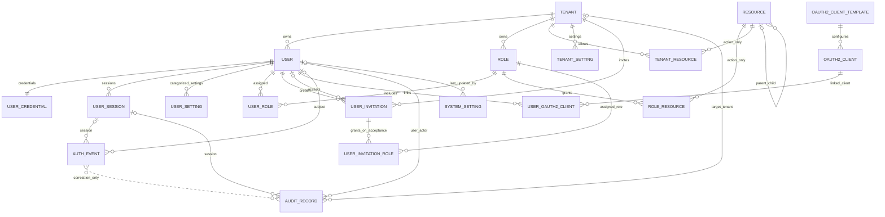

# 阶段 1：管理模块 Spec

## Problem Statement

Roseiot 当前只有阶段 0 工程基线，管理模块尚未实现。平台需要安全建立首个管理员，并为之后的多租户业务提供用户身份、租户成员、角色、资源授权和系统认证设置。没有明确的用户流程、API 契约和领域边界，会导致身份归属、跨租户授权及平台设置在实现时被各处重复解释。

## Solution

为平台运营方和租户用户建立安全、可追溯的管理能力，覆盖账户准入与认证、会话和个人账户管理、租户和成员、角色与资源授权、系统设置、MFA/OIDC、审计与认证事件，并在阶段结束时验证可靠性、代表性性能和部署流程。用户通过邀请加入单一租户；平台用户和租户管理员在明确的权限边界内管理平台级及租户级资源。

## User Stories

### 部署负责人

1. 作为部署负责人，我希望在数据库迁移完成后通过受控的一次性 SQL 引导脚本建立首个系统管理员，以便在没有公开注册入口的情况下安全启动平台。
2. 作为部署负责人，我希望引导 SQL 在重复执行时拒绝重复创建初始身份，default tenant 由 Flyway 唯一初始化，运维 SQL 只能创建一次首管账户。

### 系统管理员

3. 作为首位系统管理员，我希望首次使用临时密码登录后必须设置新密码，改密前不能执行其他管理操作，以便避免长期使用部署临时凭证。
4. 作为系统管理员，我希望创建租户并设置稳定的租户 code 与显示名称，以便建立清晰的隔离边界。
5. 作为系统管理员，我希望在创建租户时指定首位管理员邮箱和该租户获准使用的资源，以便设置权限上限并发出管理员邀请。
6. 作为系统管理员，我希望创建租户时系统初始化不可变 `TENANT_ADMIN` 及权限关联、建立首位管理员邀请，并使租户处于 `PENDING_SETUP`，以便新租户配置失败时不会留下半成品。
7. 作为系统管理员，我希望查看、停用和重新启用租户，以便控制租户访问而保留其身份及历史记录；`PENDING_SETUP` 租户只能由首位管理员邀请接受流程转为 `ACTIVE`。
8. 作为系统管理员，我希望停用租户后其用户不能登录、续期会话或执行新的租户操作，以便租户停用立即生效。
9. 作为平台用户，我希望浏览 GROUP、MENU 与 BUTTON 资源目录，以便理解系统可配置的管理端导航和授权操作。
10. 作为持有相应平台权限的平台用户，我希望维护资源名称、类型、层级、排序和展示元数据，并为 MENU 配置路由地址，以便管理端按资源目录组织导航。
11. 作为获授权的系统用户，我希望维护 BUTTON 的稳定权限标识和描述，并将权限标识分配给系统角色，以便将可授权操作与受保护的服务端行为关联并按职责授权。
12. 作为系统管理员，我希望为租户设置可用资源，以便租户角色只能取得该租户获准使用的权限。
13. 作为系统管理员，我希望查看和维护 MFA 的全局启用策略及各个已实现 MFA 方法的启停与设置，以便按部署需要开放认证因子。
14. 作为系统管理员，我希望通过 OIDC Provider 模板添加、配置、启用或停用外部身份提供商，以便控制用户可用的第三方登录来源。
15. 作为系统管理员，我希望配置 OIDC 用户属性映射并在保存前校验必要设置，以便外部身份能按明确规则关联到 Roseiot 用户。
16. 作为获授权的管理员，我希望查询管理与账户安全审计，以便追溯已认证用户发起的租户、用户、角色、权限和认证设置变更。
17. 作为系统管理员，我希望管理其他系统管理员账号时不能删除、注销或停用最后一名有效系统管理员，以便避免系统失去管理入口。
18. 作为系统管理员，我希望平台级身份默认不能读取客户租户的业务数据或秘密，以便平台管理权限不隐含租户数据访问权。

19. 作为系统管理员，我希望查看和更新平台通用设置，以便统一管理平台名称、本地化、默认时区和公开 baseUrl 等非安全偏好；邀请、密码恢复和邮箱验证邮件中的链接均使用配置的 baseUrl。
20. 作为系统管理员，我希望查看和更新平台安全策略，以便集中管理已启用的登录方式、密码规则、会话策略和登录防护。
21. 作为系统管理员，我希望配置平台邮件发送设置，以便安全可靠地发送租户邀请、密码恢复和邮箱验证邮件。
22. 作为获授权的安全管理员，我希望查询认证事件，包括尚未建立登录身份的登录尝试，以便调查认证失败和账户攻击。

### 租户管理员

23. 作为受邀用户，我希望通过发送到受邀邮箱的一次性、限时激活链接完成账户激活并设置密码，以便安全加入租户。
24. 作为租户管理员，我希望邀请新成员并可选择性地为其指定当前租户内角色，向其邮箱发送激活邮件，以便按需授予团队权限。未指定角色的成员完成激活后只能使用登录、`/api/me/**` 和明确开放的公开接口。
25. 作为租户管理员，我希望查看、重发或取消尚未完成的邀请，以便维护成员加入流程。
26. 作为租户管理员，我希望启用、停用租户成员并查看其当前角色，以便管理成员访问。
27. 作为租户管理员，我希望成员停用后其会话被撤销且历史审计仍保留稳定用户身份，以便立即阻止新操作并保留可追溯性。
28. 作为租户管理员，我希望创建、修改和停用本租户角色，以便按职责组织授权。
29. 作为租户管理员，我希望给角色分配一个或多个 BUTTON 权限资源，但不能超出本租户可用范围，以便授权符合平台设定的上限。
30. 作为租户管理员，我希望为用户分配多个本租户角色，以便组合其工作职责所需的权限标识。
31. 作为租户管理员，我希望删除、注销、停用成员或变更成员角色/权限时，系统保证租户仍至少有一名有效租户管理员，以便避免租户失去自主管理能力。
32. 作为租户管理员，我希望资源查询和变更自动限定在当前身份所属租户，以便不能通过伪造 tenant ID 管理其他租户成员或角色。

### 获授权的管理员

33. 作为获授权的系统管理员，我希望仅在持有相应权限标识时执行系统级租户、资源目录和系统设置操作，以便操作权限可被独立授予与审计。
34. 作为获授权的租户管理员，我希望仅在持有相应权限标识时管理本租户成员、邀请和角色，以便租户内部职责可以细分。
35. 作为获授权的操作者，我希望未授权请求得到一致拒绝，且不能通过直接调用 API 绕过管理端页面限制，以便服务端是最终授权边界。
36. 作为获授权的管理员，我希望查询列表支持有界分页和允许字段排序，以便管理规模增长时响应资源可控。

### 用户

37. 作为用户，我希望使用全平台唯一、规范化的邮箱和密码登录，以便通过稳定身份访问平台。
38. 作为用户，我希望使用已启用且已关联到账户的 OIDC Provider 登录，以便通过外部身份提供商认证。
39. 作为用户，我希望登录失败时邮箱不存在、密码错误、账户停用或租户停用不会被不同响应区分，以便减少账户枚举。
40. 作为用户，我希望查看自己当前的登录会话及其设备/时间信息，以便了解账户访问情况。
41. 作为用户，我希望撤销指定会话或退出所有会话，以便在设备遗失或怀疑凭证泄露时终止访问。
42. 作为用户，我希望刷新会话凭证时旧刷新凭证失效，并在检测到重放时撤销对应会话族，以便降低凭证复制风险。
43. 作为用户，我希望使用当前密码修改密码并可撤销其他会话，以便主动保护账户。
44. 作为忘记密码的用户，我希望请求账户恢复并通过一次性、限时恢复凭证重设密码，以便恢复账户访问。
45. 作为用户，我希望账户恢复请求不暴露邮箱是否存在，且成功重置后旧会话被撤销，以便降低枚举风险并保护账户。
46. 作为用户，我希望更新自己的个人资料，以便保持个人信息准确。
47. 作为用户，我希望提交新邮箱并完成新邮箱验证后再切换登录标识，以便避免误填邮箱导致账户失联。
48. 作为用户，我希望在启用、停用 MFA 或更改 MFA 因子前重新验证身份，以便保护高风险账户设置。
49. 作为用户，我希望查看、启用、验证和停用当前部署已开放的 TOTP、Passkey/WebAuthn 与已验证邮箱一次性验证码因子，以便提高账户认证强度。
50. 作为用户，我希望查看并解除自己已关联的 OIDC 身份，但不能解除最后一个可用登录方式，以便管理登录方式且避免账户锁定。
51. 作为用户，我希望高风险的密码、邮箱、MFA 和外部身份变更需要近期重新认证，以便阻止被盗会话直接接管账户。
52. 作为用户，我希望没有公开自助注册入口，只有收到有效邀请才能创建租户用户账户，以便平台维持受控准入。
53. 作为用户，我希望经近期重新认证并明确确认后立即注销自己的账户，清除个人资料和认证材料并保留无个人资料的稳定 User ID 供历史审计关联，以便停止使用平台。
54. 作为用户，我希望生成和轮换一次性 MFA 恢复码，并在失去全部 MFA 因子及恢复码后通过人工支持身份核验恢复访问，以便避免账户永久锁定。

55. 作为启用了 MFA 的用户，我希望登录时完成当前账户要求的第二因子验证后才建立完整会话，以便密码泄露本身不足以访问账户。

## Implementation Decisions

### 范围与领域边界

- 阶段 1 是一个管理模块阶段，按可独立验证的垂直切片交付；本 Spec 定义阶段级范围和跨切片约束，具体实现任务可在计划阶段拆分。
- 后端采用模块化单体、Spring Boot MVC、MyBatis-Plus Mapper、PostgreSQL 与 Flyway。只建立当前切片需要的功能边界，不预建空模块。API 请求/响应模型与持久化模型分离。
- 用户是人类主体，必须且只属于一个租户；系统用户属于保留 `default` tenant，客户用户属于各自客户租户。用户可拥有所属租户中的多个角色，也可没有角色。Tenant、User、Role、Resource 与设置使用内部自增 BIGINT，Tenant 另以唯一 code 对外定位。
- Role 只属于一个 Tenant，不设置权限范围字段。`default` tenant 只承载系统角色，客户租户只承载租户角色；角色名称仅用于展示。创建客户租户时配置 `tenant_resource`，创建不可变 `TENANT_ADMIN` 并关联该租户获准的租户管理权限标识，再向指定邮箱发送必定授予该角色的一次性邀请。内置角色名称固定，不可由表单修改。其他普通角色只能关联源码定义且租户获准使用的权限标识。Flyway 初始化受保护 `SYSTEM_ADMIN` 及完整系统管理权限关联，首管由运维 SQL 绑定该角色。
- Resource 不包含权限范围属性，类型为 `GROUP`、`MENU` 或 `BUTTON`。字段包括名称、权限标识、排序值、可空 `parentId`、图标及展示元数据；GROUP/MENU 的权限标识可空，BUTTON 必填。仅 MENU 可有路由地址，GROUP 和 BUTTON 不得有路由地址。层级为 GROUP→MENU→BUTTON；GROUP/MENU 只组织导航，不直接授权 API，父级不隐式授予子项权限。
- 每个受保护 API 操作绑定源码定义的稳定权限标识，格式为 `模块:资源:动作`，例如 `system:user_setting:update`；每个 BUTTON Resource 对应一个权限标识，角色通过 `role_resource` 获得权限。服务端还须检查用户状态、资源归属和租户归属。客户用户只能操作自身租户；系统管理员可凭角色权限标识管理指定客户租户的租户管理资源，但不能因此访问其业务数据。请求中的 `tenantId` 只定位目标，不是授权凭据。未分配角色的用户仅可访问 `/api/me/**` 和明确开放的公开接口。
- 公开注册不开放；所有受邀用户（包括系统用户）均通过邮件邀请加入。首位系统管理员由数据库迁移后的受控一次性运维 SQL 建立，不提供 `/api/setup` 或公开初始化 API。运维 SQL 使用安全提供的规范化邮箱及密码哈希、事务、唯一约束和并发保护创建 User、UserCredential、UserRole 与引导审计；首次登录须改密，改密前只允许修改密码或撤销当前会话。

### API 契约概览

所有 API 使用 JSON，采用资源路径和明确状态转换；不得使用 PATCH、201、202 或 204。成功响应使用 200，并返回资源或操作结果；校验、认证、授权、资源不存在、冲突和业务规则错误使用稳定的统一错误模型。写操作均校验当前主体、租户归属、状态转换和必要的近期重新认证。

#### API 路径分组规则

- `/api/auth/**`：认证流程，包括本地登录（保留已确认的 `POST /api/auth/login`）、会话刷新资源创建、密码恢复及认证方式发起。登出通过对当前 `UserSession` 执行撤销状态转换完成。OIDC 协议回调由 Spring Security 管理，不把协议票据放入普通资源 API。
- `/api/me/**`：当前认证用户的个人资料、密码、邮箱、会话、MFA 与外部身份；目标用户只从认证主体确定，不接受用户 ID 来切换操作对象。用户级设置由 `UserSetting` 按类别持有（每用户每类别至多一条），并通过 `/api/me/settings/{category}` 自助管理；首批类别包括 `mfa`（用户启用的因子及首选方法）、`oauth2`（用户是否允许通过已关联外部身份登录）和 `appearance`（语言、主题、时区）。MFA 注册流程使用当前用户的 `/api/me/mfa-enrollments` 资源，一次性恢复码通过 `/api/me/mfa-recovery-code-sets` 创建或轮换。设置类别采用明确字段和类型校验，不开放任意键值写入；因子秘密等敏感值须加密保护，恢复码只保存不可逆摘要，不作为普通设置明文读回。
- `/api/tenants` 与 `/api/tenants/{tenantId}/**`：Tenant 拥有的用户、邀请、角色、租户可用资源及租户设置。普通客户用户只能访问所属 Tenant；系统管理员须持有所需权限标识，方可按路径中的 tenantId 管理客户租户资源。租户设置使用 `TenantSetting`，未定义用例前不开放设置字段。邀请请求不能直接分配资源或权限标识，只能选择当前 Tenant 内角色 ID。待启用租户的首位管理员邀请必须授予该租户 `TENANT_ADMIN`；一般邀请可不指定角色，或指定一个或多个当前 Tenant 角色。
- `/api/system-settings/**`：系统设置按 `general`、`security`、`password-policy`、`mfa`、`oauth2`、`mail` 类别管理，每类使用固定字段校验，不开放任意键值写入。操作检查当前角色关联的权限标识。OAuth2 客户端/模板、全局资源目录、审计记录与认证事件分别使用独立资源路径；审计和认证事件按记录 tenantId 及调用者权限过滤。
- API 路径按领域所有权组织：拥有关系明确时嵌套于拥有者资源；当前主体范围使用 `/api/me/**`；独立领域模型使用顶层资源路径。路径用名词标识资源，不用动词表达 CRUD。集合使用 GET/POST，单资源读取使用 GET，普通资源完整更新使用 PUT；具有领域规则、副作用或独立授权要求的状态转换使用 POST 动作子路径；真正删除或解除关联使用 DELETE。重发、接受、验证等操作通过 POST 创建相应请求/结果资源。项目约束是不使用 PATCH、201、202 或 204，成功响应使用 200。每个受保护操作绑定稳定权限标识；路径本身不作为权限标识。

### 平台与租户权限标识初始化和授权

- 权限标识采用 `模块:资源:动作` 格式，在源码中定义，并绑定受保护 API 操作；每个可分配标识对应一个 BUTTON Resource。Flyway 初始化 default tenant、资源目录以及受保护 `SYSTEM_ADMIN` 和其 `role_resource` 关联，不允许在数据库临时定义服务端未知的权限标识。权限标识变更须同步更新代码、资源种子和契约测试。
- Resource 字段含 `type`（GROUP/MENU/BUTTON）、`name`、可空稳定 `permissionIdentifier`、`sortOrder`、可空 `parentId`、`icon`、描述、状态及展示元数据，不设权限范围字段。仅 MENU 可设置 `routeAddress`；BUTTON 权限标识必须在源码中定义且全局唯一；GROUP/MENU 的权限标识可空且不直接授权 API。父子 Resource 必须遵循 GROUP→MENU→BUTTON 层级。
- 受保护内置 `SYSTEM_ADMIN` 属于 default tenant，由 Flyway 建立并关联全部系统管理权限标识；`TENANT_ADMIN` 在每个客户租户创建时建立，并关联该 Tenant 获准使用的全部租户管理权限标识。两个内置角色的记录、名称、状态及权限关联不可通过 API 修改、停用或删除。首管运维 SQL 将首位用户绑定 SYSTEM_ADMIN。其他角色只可关联源码已定义的权限标识；租户角色还必须满足该租户 `tenant_resource` 许可。系统用户对客户租户的管理操作必须有对应权限标识，不能因此访问客户业务数据。
- `tenant_resource` 关联客户租户获准使用的 `tenant:*` BUTTON 权限资源；`role_resource` 关联角色实际授予的 BUTTON 权限。所有客户租户角色（含 TENANT_ADMIN）的 `role_resource` 必须是对应 `tenant_resource` 的子集；tenant_resource 本身不授予用户权限，并且需包含租户管理及维护最后管理员约束所需的基础资源。
- 权限标识均由源码定义，格式为三个非空段 `模块:资源:动作`，例如 `system:user_setting:update`。下表中 module、resource、action 组合为需分别登记的完整权限标识；不使用通配符授权。

| 模块 | 资源 | 动作 |
| --- | --- | --- |
| `system` | `tenants` | `read`, `create`, `update`, `activate`, `deactivate` |
| `system` | `users` | `read`, `update`, `activate`, `deactivate` |
| `system` | `invitations` | `read`, `create`, `cancel`, `deliver` |
| `system` | `roles` | `read`, `create`, `update`, `activate`, `deactivate` |
| `system` | `resources` | `read`, `create`, `update`, `activate`, `deactivate` |
| `system` | `tenant_resources` | `read`, `update` |
| `system` | `system_settings_general`, `system_settings_security`, `system_settings_password_policy`, `system_settings_mfa`, `system_settings_oauth2`, `system_settings_mail` | `read`, `update` |
| `system` | `oauth2_clients` | `read`, `create`, `update`, `activate`, `deactivate` |
| `system` | `oauth2_client_templates` | `read` |
| `system` | `audit_records` | `read` |
| `system` | `auth_events` | `read` |
| `tenant` | `users` | `read`, `update`, `activate`, `deactivate` |
| `tenant` | `invitations` | `read`, `create`, `cancel`, `deliver` |
| `tenant` | `roles` | `read`, `create`, `update`, `activate`, `deactivate` |
| `tenant` | `resources` | `read` |

`SYSTEM_ADMIN` 关联所有 `system:*` 系统管理标识；`TENANT_ADMIN` 关联该租户获准的全部 `tenant:*` 租户管理标识。tenant_resource 必须包含维持租户成员、邀请、角色管理与最后管理员不变量所需的基础权限。

### 领域模型与 API 资源归属

| 领域模型/关系 | 所属领域或拥有者 | API 资源路径 | 暴露方式 |
| --- | --- | --- | --- |
| Tenant | 平台管理的顶层实体 | `/api/tenants` | 独立集合资源 |
| User | 由 Tenant 拥有；本人视角由当前主体确定 | `/api/tenants/{tenantId}/users`、`/api/me/**` | 管理端嵌套于 Tenant；自助端不接受 userId |
| Role | 由 Tenant 拥有 | `/api/tenants/{tenantId}/roles` | 租户子资源 |
| UserInvitation | 由 Tenant 拥有 | `/api/tenants/{tenantId}/invitations` | 租户子资源；投递/接受请求使用顶层请求资源以限制嵌套深度 |
| TenantSetting | 由 Tenant 拥有 | `/api/tenants/{tenantId}/settings/**` | 租户子资源；具体类别未定义前不开放端点 |
| UserSession、UserSetting | 由 User 拥有 | `/api/me/sessions`、`/api/me/settings/{category}` | 仅当前用户可访问；每用户每类别至多一条 UserSetting（`userId + category` 唯一） |
| UserCredential | 用户密码与恢复凭证内部模型 | 无公开资源路径 | 仅认证/账户安全服务访问；只保存密码凭证和账户恢复状态，不包含 MFA 设置或 MFA 因子材料 |
| UserOAuth2Client | User 与 OAuth2Client 的关联 | `/api/me/external-identities` | 通过当前用户关联资源操作 |
| Resource | 全局权限目录 | `/api/resources` | 独立顶层资源 |
| SystemSetting | 平台级设置类别 | `/api/system-settings/{category}` | 单例类别资源，如 `general`、`mfa`、`oauth2` |
| OAuth2Client | 独立的平台 OAuth2 客户端配置实体 | `/api/oauth2-clients` | 独立顶层资源，不嵌套在 `SystemSetting` 或模板下 |
| OAuth2ClientTemplate | 独立的只读模板目录实体 | `/api/oauth2-client-templates` | 独立顶层只读集合；客户端保存来源模板 ID |
| AuditRecord、AuthEvent | 独立审计与认证事件记录 | `/api/audit-records`、`/api/auth-events` | 独立只读查询资源；内部通过事件服务产生记录 |
| UserRole、RoleResource、TenantResource、UserInvitationRole | 各自拥有者与目标之间的关联模型 | 不建立独立顶层路径 | 分别随 User、Role、Tenant、UserInvitation 表示读写；关联两端由服务端校验 |
| 首管账户 | 由 default Tenant 与受保护平台 Role 确定 | 无 API 路径 | 运维 SQL 在迁移后创建账户、角色关联和引导 AuditRecord；不暴露初始化 API |

路径中只有确有领域拥有关系时才使用嵌套。权限标识、租户归属和当前用户身份由服务端校验，不因路径结构自动授予访问权。

| 用途 | API 资源/操作 | 关键行为 |
| --- | --- | --- |
| 首管 SQL 引导 | 无 API | Flyway 已初始化 default tenant、源码定义的 GROUP/MENU/BUTTON 资源及受保护的 `SYSTEM_ADMIN` Role 后，由部署人员运行一次性参数化 SQL；SQL 锁定受保护系统管理员 Role 并检查尚无绑定用户，在同一事务插入首位 User、带 `mustChangePassword=true` 的 UserCredential、UserRole 及 `SYSTEM_BOOTSTRAP_COMPLETED` AuditRecord。临时密码哈希由部署人员通过项目支持的离线密码哈希工具生成并作为必需参数提供，脚本无默认账户/密码、不写入明文秘密；首登后仅允许密码修改和当前会话撤销，改密成功即清除强制改密状态并写审计记录。重复执行失败且不改变现有账户。|
| 登录 | `POST /api/auth/login`、`POST /api/auth/session-refreshes` | 邮箱密码登录、刷新凭证轮换；登录和刷新不泄露账户存在性。启用 MFA 的账户须先完成第二因子验证，才建立完整会话；具体挑战资源契约在 MFA 垂直切片 Spec 中细化。强制改密期间仅允许改密与当前会话撤销。 |
| 密码恢复 | `POST /api/auth/password-reset-requests`、`POST /api/auth/password-resets` | 通用请求响应；使用短期单次令牌完成重置。 |
| 用户自助 | `GET/PUT /api/me/profile`、`POST /api/me/account-withdrawals`、`POST /api/me/password-changes`、`POST /api/me/email-change-requests`、`POST /api/me/email-changes`、`GET/PUT /api/me/settings/appearance`、`GET/PUT /api/me/settings/oauth2` | 目标用户从认证主体确定；邮箱切换需验证新地址；敏感变更需重新认证。账户注销需近期重新认证并明确确认，立即进入不可逆 `WITHDRAWN` 状态，撤销会话、移除角色和外部身份关联、删除凭证及 MFA 材料并清除个人资料；保留不含个人资料的稳定 User ID 和 Tenant 归属，供历史审计关联；不得注销最后一名系统管理员或有效租户的最后一名租户管理员。外观设置只包含明确支持的语言、主题和时区字段。 |
| 会话 | `GET /api/me/sessions`、`POST /api/me/sessions/{sessionId}/revocations`、`POST /api/me/sessions/current/revocations`、`POST /api/me/sessions/revocations` | 查看本人会话；撤销单个会话使用 `POST /api/me/sessions/{sessionId}/revocations`，当前会话用 `POST /api/me/sessions/current/revocations`，全部会话用 `POST /api/me/sessions/revocations`（不含当前会话）；服务端保留会话历史且不提供令牌内容。 |
| MFA | `GET/PUT /api/me/settings/mfa`、`GET/POST /api/me/mfa-enrollments`、`GET /api/me/mfa-enrollments/{enrollmentId}`、`POST /api/me/mfa-enrollments/{enrollmentId}/verifications`、`POST /api/me/mfa-enrollments/{enrollmentId}/cancellations`、`POST /api/me/mfa-recovery-code-sets` | 首批因子为 TOTP、Passkey/WebAuthn 与已验证邮箱一次性验证码；用户启用的因子类型及首选方法属于 `UserSetting(mfa)`，因子注册状态与流程凭据属于 enrollment 资源。Email MFA 仅发送到已验证邮箱，验证码限时、单次使用并受发送与验证频率限制；不能用邮箱验证码替代全部 MFA 因子丢失后的人工身份核验流程。用户可创建或轮换一次性恢复码集，完整恢复码仅创建时返回，服务端仅保存摘要。仅平台启用且已实现的方法可用。系统级方法策略保存在 `SystemSetting(mfa)`；不建独立 `MfaFactor` 领域实体。失去全部因子和恢复码时须经人工支持身份核验并审计重置，不允许仅凭邮箱自助解除。 |
| 用户 OAuth2 设置 | `GET/PUT /api/me/settings/oauth2` | 管理用户是否允许通过已关联外部身份登录；关闭时拒绝该用户的 OIDC 登录但不解除身份关联；仅在平台 OAuth2 策略启用时生效，不创建/删除身份关联。 |
| 外部身份 | `GET/POST /api/me/external-identities`、`DELETE /api/me/external-identities/{identityId}` | 该资源表达 UserOAuth2Client 外部身份关联，不是 OAuth2Client 配置；仅关联/解除本人的 OIDC 身份，必须验证提供商身份，不能仅凭相同 email 自动绑定。 |
| 租户 | `GET/POST /api/tenants`、`GET/PUT /api/tenants/{tenantId}`、`POST /api/tenants/{tenantId}/activate`（仅重新启用 DISABLED 租户）、`POST /api/tenants/{tenantId}/deactivate`、`GET/PUT /api/tenants/{tenantId}/resources` | 操作由系统管理员有效角色关联的权限标识保护；创建请求包含基本资料、获准资源和首位管理员邮箱。创建后 Tenant 状态为 `PENDING_SETUP`；`activate` 只用于重新启用已停用租户，待启用租户只能在首位管理员接受邀请时转为 ACTIVE。
| 邀请与用户 | `GET/POST /api/tenants/{tenantId}/invitations`、`GET /api/tenants/{tenantId}/invitations/{invitationId}`、`POST /api/tenants/{tenantId}/invitations/{invitationId}/cancel`、`POST /api/invitation-delivery-requests`、`POST /api/invitation-acceptances`、`GET /api/tenants/{tenantId}/users`、`GET/PUT /api/tenants/{tenantId}/users/{userId}`、`POST /api/tenants/{tenantId}/users/{userId}/activate`、`POST /api/tenants/{tenantId}/users/{userId}/deactivate` | 所有邀请（含 default tenant 内系统用户邀请）都必须发送激活邮件。一般邀请可不指定角色或指定本 Tenant 内一个或多个角色；首位租户管理员邀请必须指定不可变 `TENANT_ADMIN`。邀请不能直接指定 Resource ID 或权限标识。接受时必须设置密码并以一次性 token 验证邮箱控制权；普通接受流程创建 User、UserCredential 和邀请角色关联。首位管理员接受流程还须原子地将 Tenant 从 `PENDING_SETUP` 转为 `ACTIVE`。邮件通过事件异步发送，失败可重试；重发轮换 token 并使旧 token 失效。系统管理员按目标租户管理用户时须有对应权限标识，普通用户只能访问自身 Tenant。
| 角色与授权 | `GET/POST /api/tenants/{tenantId}/roles`、`GET/PUT /api/tenants/{tenantId}/roles/{roleId}`、`POST /api/tenants/{tenantId}/roles/{roleId}/activate`、`POST /api/tenants/{tenantId}/roles/{roleId}/deactivate` | 内置 `SYSTEM_ADMIN` 与 `TENANT_ADMIN` 不可修改、停用或删除，其权限关联也不可修改。系统管理员可通过 default tenant 的角色 API 管理普通系统角色，租户管理员可管理本租户普通角色；普通角色通过 `role_resource` 关联已定义权限标识。租户普通角色及 TENANT_ADMIN 的关联不得超出 `tenant_resource` 许可集。系统与租户角色管理操作分别检查角色所关联的权限标识。
| 资源目录 | `GET/POST /api/resources`、`GET/PUT /api/resources/{resourceId}`、`POST /api/resources/{resourceId}/activate`、`POST /api/resources/{resourceId}/deactivate` | 资源为全局目录，不含权限范围字段；类型为 GROUP/MENU/BUTTON，只有 BUTTON 有稳定权限标识并绑定受保护 API 操作，GROUP/MENU 不直接授权；仅 MENU 有 routeAddress。资源管理操作检查当前角色关联的权限标识。
| 通用系统设置 | `GET/PUT /api/system-settings/general` | 仅获授权系统管理员可查看和修改平台通用偏好；只接受明确列出的设置字段。 |
| 安全设置 | `GET/PUT /api/system-settings/security` | 管理登录方式、会话和登录防护策略；密码复杂度/长度等独立由 `password-policy` 类别管理。 |
| 密码策略 | `GET/PUT /api/system-settings/password-policy` | 管理平台密码规则；与安全策略分开校验、授权和审计，不能以任意 key/value 写入。 |
| MFA 设置 | `GET/PUT /api/system-settings/mfa` | 管理平台启用策略、已实现方法及系统级/共享 MFA 提供方配置秘密；秘密只写不读。用户专属因子秘密不在此资源中。 |
| OAuth2 设置 | `GET/PUT /api/system-settings/oauth2` | 管理平台 OAuth2/OIDC 登录总开关和全局策略；客户端注册通过独立的 `/api/oauth2-clients/**` 资源管理。 |
| OAuth2 客户端 | `GET/POST /api/oauth2-clients`、`GET/PUT /api/oauth2-clients/{oauth2ClientId}`、`POST /api/oauth2-clients/{oauth2ClientId}/activate`、`POST /api/oauth2-clients/{oauth2ClientId}/deactivate` | 从只读模板选择配置并创建 `OAuth2Client`；凭证按客户端作用域保护存储，client secret 只写不读；启停通过状态转换操作完成；校验 mapperConfig。 |
| OAuth2 模板 | `GET /api/oauth2-client-templates` | 只读查询模板目录；模板不包含部署专属凭证。 |
| 邮件设置 | `GET/PUT /api/system-settings/mail` | 配置和读取 SMTP 发件设置；仅系统管理员可操作；密码只写不读，响应仅提供是否已配置的状态。 |
| 管理审计 | `GET /api/audit-records`、`GET /api/audit-records/{recordId}`，支持 actor、权限标识、target、outcome、时间范围和分页筛选 | 记录用户及指定系统生命周期操作；USER actor 必须关联用户，BOOTSTRAP/SYSTEM actor 可没有 `actorUserId`；每条记录明确 actorType 和 tenant 范围；按获授权范围分页检索；不返回密码、token、factor secret、client secret 或完整敏感请求体。 |
| 认证事件 | `GET /api/auth-events`、`GET /api/auth-events/{eventId}`，支持 `eventType`、`subjectUserId`、`outcome`、认证方式、时间范围和分页筛选 | 记录认证边界上的成功/失败事件，允许 `subjectUserId` 为空；只读并由专门 BUTTON 权限标识授权，不要求事件主体已登录。 |

路径中的 `tenantId` 仅用于定位目标租户资源，不构成授权凭据。普通客户用户只能访问所属 Tenant；系统管理员持有所需权限标识时可管理指定客户 Tenant 的租户管理资源，但不因此获得其业务数据访问权。

OIDC 登录采用服务端受控的 provider registration 与标准 OIDC 授权码流程；回调、state、nonce、issuer、audience、签名和重定向 URI 校验交由 Spring Security 支持，不自行实现协议。Provider 不接受由普通登录请求任意指定的 issuer 或任意端点。OIDC 用户映射以验证后的稳定外部身份为准，不以 email 单独自动合并账户；邀请制要求外部身份关联到已存在的本地 User。

### 管理模块领域模型关系

- `UserRole`、`RoleResource`、`TenantResource` 和 `UserInvitationRole` 是显式关联模型/关系表；关联表使用关系两端 ID 构成复合主键。RoleResource/TenantResource 只关联 BUTTON Resource，不把 GROUP/MENU 直接纳入授权。
- `UserInvitationRole` 保存接受邀请后要授予的角色集合；一般邀请可关联零个或多个当前 Tenant 内角色，首位管理员邀请必须关联 `TENANT_ADMIN`。接受邀请时仅当关联角色非空才创建 UserRole；每个角色必须属于邀请的 Tenant。系统用户邀请可指定 default tenant 中的普通系统角色，不得变更 SYSTEM_ADMIN。角色权限仅由 RoleResource 管理。无角色用户仅可访问 `/api/me/**` 与公开接口。
- 每个未注销 User 与 UserCredential 一对一；`WITHDRAWN` User 不再有认证凭证。每个 User 对每种 UserSetting 类别至多一条（唯一键为 `userId + category`）；TenantSetting 按已定义设置类别存储，一个 Tenant 可有多条。SystemSetting 是全平台设置，不属于租户；其 `updatedBy` 指向最近修改者。
- UserInvitation 由一个 User 创建，接受前没有 accepted User，成功接受后最多关联一个 User；目标邮箱是邀请发出时的受邀主体标识。
- 首管建立属于平台生命周期操作，不是认证尝试，因此不写入 `AuthEvent`；受控运维 SQL 在同一事务中创建首管 User/UserCredential、系统管理员 UserRole 及 `SYSTEM_BOOTSTRAP_COMPLETED` AuditRecord，记录 `actorType=BOOTSTRAP`、空 `actorUserId`、default tenant ID 和新管理员 userId；该引导审计由运维 SQL 同事务插入而非异步 Service。通过锁定受保护系统管理员 Role、检查已有首管关联及唯一约束保证 SQL 重复/并发运行不能创建第二套初始身份；不提供 `/api/setup`，也不依赖异步审计状态判断初始化完成。
- UserOAuth2Client 是 User 与 OAuth2Client 的持久化关联；对同一 `issuer + subject` 只允许关联一个 User。OAuth2ClientTemplate 被客户端创建时引用为来源，模板修改不级联覆盖客户端快照。
- Resource 的 `parentId` 是可空自关联，仅用于 GROUP→MENU→BUTTON 层级组织；Resource 全局共享，不按租户划分；仅 MENU 可有路由地址，父级不隐含权限继承。
- AuthEvent 的 `subjectUserId` 和 `sessionId` 均可空。AuditRecord 通过 `actorType` 区分 USER、BOOTSTRAP、SYSTEM 等发起方；仅当 `actorType=USER` 时要求 `actorUserId` 非空。记录可空的 `actorTenantId`、可空的目标 `tenantId`、可空的目标 `userId` 及可选 `sessionId`。首管完成记录的 `tenantId` 指向 default tenant，`userId` 指向新建的首位管理员。AuthEvent 与 AuditRecord 仅可通过可选 `correlationId`/`sessionId` 相关联，不建立必需的一对多外键或级联关系。
- 审计目标通过 `targetType + targetId` 表示多种资源，不建立指向所有业务表的多态外键；资源存在性和授权范围在应用服务中验证。
- 用户和角色 API 走 `/api/tenants/{tenantId}/users/**` 与 `/api/tenants/{tenantId}/roles/**`。Resource 是全局权限目录，走 `/api/resources/**`；路径组织体现资源所有权，不能替代逐请求的服务端授权检查。

### 领域模型字段概览

- **Tenant**：`id`、唯一 `code`、`displayName`、`status`、`createdAt`、`updatedAt`。停用保留历史和关联数据，不做普通 API 物理删除。
- **User**：`id`、`tenantId`、全平台唯一且规范化的 `email`、`displayName`、`status`、`createdAt`、`updatedAt`、可空 `withdrawnAt`。User 状态为 `ACTIVE`、`DISABLED` 或不可逆终态 `WITHDRAWN`。账户注销将邮箱替换为唯一、不可投递的 `.invalid` 地址，清除显示名称及其他个人资料，但保留稳定 ID 和 Tenant 归属。系统管理员的 `tenantId` 指向 default 租户；用户不支持跨租户成员关系。首管账户由运维 SQL 创建，`UserCredential.mustChangePassword=true`；default tenant 是 Flyway 种子数据。
- **UserCredential**：独立于 `User` 表存储的认证凭证记录；未注销 User 与其一对一，以 `userId` 作为共享主键并同时作为指向 `User.id` 的外键；仅包含 `passwordHash`、`passwordChangedAt`、账户恢复状态摘要与有效期、`mustChangePassword`。账户注销时删除该凭证记录。临时密码首次登录后只允许改密和当前会话撤销；改密成功后清除此标记。MFA 与 UserCredential 无领域关系：用户 MFA 状态和受保护因子秘密均由 `UserSetting(mfa)` 持有；不得在 `User` 中存储密码哈希，也不得保存明文密码、恢复 token 或恢复码。
- **UserSession**：`id`、`userId`、刷新 token 摘要/会话族标识、创建/最近使用时间、空闲与绝对过期时间、撤销时间及原因。账户注销时撤销该用户全部会话；不得向 API 或日志暴露原 token。
- **UserInvitation**：`id`、`tenantId`、规范化目标 email、token 摘要、`createdByUserId`、可空 `acceptedUserId`、有效期、状态、接受/取消时间。`UserInvitationRole` 为可选关联，可将零个或多个当前 Tenant 内角色分配给接受邀请的用户；邀请不直接关联 Resource 或权限标识。重发时轮换 token 并立即使旧 token 失效；邀请有效期和重发频率在实现计划中固定。账户注销时清除已接受邀请中可识别该用户的目标 email。持有发送至目标邮箱的有效邀请链接视为邮箱控制验证。
- **Role**：`id`、`tenantId`、稳定可选 `code`、显示名称、状态、创建/更新时间；不设置权限范围字段。`SYSTEM_ADMIN` 和 `TENANT_ADMIN` 为不可变内置角色；角色名不授权 API。
- **Resource**：`id`、`type`（GROUP/MENU/BUTTON）、`name`、可空稳定 `permissionIdentifier`、`sortOrder`、可空 `parentId`、`icon`、描述、状态及展示元数据；全局共享，不设权限范围字段。仅 MENU 可设置 `routeAddress`；BUTTON 权限标识全局唯一，GROUP/MENU 不直接授权；层级为 GROUP→MENU→BUTTON。
- **tenant_resource / role_resource**：分别关联 Tenant 与 Resource、Role 与 Resource；仅关联 BUTTON。tenant_resource 是系统管理员配置给租户的可用资源清单，role_resource 是角色实际授予的权限。租户角色的 role_resource 必须是对应 tenant_resource 的子集；该许可集本身不授予用户操作权限。
- **OAuth2ClientTemplate**：系统提供的可复用 OAuth/OIDC 注册模板，包含 `id`、稳定 `code`、显示名称、描述、默认 issuer/discovery 或协议端点、scope、client authentication method、经校验的默认 `mapperConfig`、状态和版本；不保存 client ID、client secret 或其他部署专属秘密。当前只需查询模板目录，不提供运行时模板管理 API。
- **OAuth2Client**：`id`、`templateId`（来源模板）、稳定 `registrationId`、显示名称、issuer/discovery 配置、client ID、受保护 client secret、启用状态及经校验的 `mapperConfig`。创建时复制模板的默认值；后续模板变更不自动改写已创建客户端，必须由管理员显式更新。配置负责将已验证的 OIDC claims 映射到允许的本地用户资料字段，至少明确稳定身份 `issuer + sub` 及登录邮箱来源，可选映射显示名称等资料；不得映射 tenant、role 或权限标识，也不能仅凭 email 自动合并/关联账户。受邀请用户的关联仍须走明确的邀请接受或已认证账户关联流程。一个客户端持有一份 mapper 配置；当前不单独建立映射关系表。client secret 不出现在读取响应和审计字段差异。
- **UserOAuth2Client**：独立持久化本地 User 与已配置 `OAuth2Client` 的关联，字段包括 `id`、`userId`、`oauth2ClientId`、经过验证的 `issuer`、`subject`（OIDC `sub`）和关联时间。`OAuth2Client.mapperConfig` 定义如何解释 claims，`UserOAuth2Client` 负责持久化已确认的用户-客户端关联；两者不可互相替代。对同一 issuer+subject 只允许关联一个本地 User；一个 User 可关联多个 UserOAuth2Client，一个 OAuth2Client 可关联多个 UserOAuth2Client。关联必须来自有效邀请接受或已认证账户主动关联，不能通过 email 自动匹配创建；解除不得让用户失去所有有效登录方式。
- **UserSetting**：用户级分类设置记录，以 `userId + category` 唯一关联用户的一种设置；每个用户对每类最多一条，类别为 `mfa`（TOTP 加密秘密、WebAuthn 凭证标识与公钥材料、Email MFA 状态与验证码摘要/有效期/消费状态、一次性恢复码摘要及启用状态）、`oauth2`（是否允许通过已关联外部身份登录）和 `appearance`（语言、主题、时区）。各类别使用专属强类型 schema、字段校验和 `/api/me/settings/{category}` 资源，不提供任意键值写入。因子注册通过独立 enrollment 流程；秘密不作为普通设置明文读回，不建独立 `MfaFactor` 领域模型。账户注销时删除所有用户设置。
- **SystemSetting**：平台级强类型设置模型，按类别（`general`、`security`、`password-policy`、`mfa`、`oauth2`、`mail`）保存经过校验的配置、版本、更新时间和操作者；每个类别有明确 schema，不提供任意键值写入。通用设置可包含平台显示名称、默认 locale、默认 time zone 和公开 baseUrl；安全设置包含全局登录方式、会话和登录防护策略；密码策略单独保存密码规则；MFA 保存全局方法策略及确属系统共享的提供方配置秘密；OAuth2 保存全局启用策略；邮件保存 SMTP host/port、username、受保护 password、from address/display name、TLS 模式和超时。秘密不可从 API 读取，更新中省略秘密字段表示保留现值。用户级设置由 `UserSetting` 按类别保存，每用户每类别至多一条，包括 MFA 启用因子/首选方法、OAuth2 登录偏好、外观设置（语言、主题、时区）；每类有明确字段和校验，不提供任意键值写入。用户专属 MFA 因子秘密/恢复材料作为 `UserSetting(mfa)` 中受保护的因子值保存并加密，不单独建立 `MfaFactor` 领域模型，也不与 `UserCredential` 混合。`UserCredential` 只保存密码与账户恢复凭证。具体 OAuth2 客户端注册与其 client secret 由 `OAuth2Client` 持有，而不是放在通用 OAuth2 设置里。
- **TenantSetting**：租户级设置模型，以 `tenantId` 归属单一租户，承载经批准的租户级配置；租户设置 API 必须位于 `/api/tenants/{tenantId}/**` 并按租户边界授权。具体设置用例和字段未定义前，不预建任意键值接口或虚构字段。
- **审计记录创建方式**：审计采用 AOP 自动记录与显式 Service 调用并行。AOP 仅拦截明确标记/配置的应用服务用例，提取 action、actor、租户范围、目标、结果和关联 ID，并发布类型化审计事件；不得序列化请求/响应全文或记录秘密。切面无法可靠推导上下文的平台生命周期事件由业务服务显式调用审计 Service；唯一例外是首管运维 SQL 在同一事务内直接插入引导 AuditRecord。事件在核心业务事务提交后异步处理并持久化 AuditRecord；同一用例只能走一种发布路径，避免重复。审计 Service 是统一校验和发布入口，后台处理须支持失败重试与幂等。审计事件需在核心事务中可靠登记，以免进程在提交后、异步处理前退出造成丢失；采用范围受限的事务性事件/outbox，不预建通用事件平台。
- **认证事件创建方式**：所有认证事件仅由认证流程显式调用 AuthEvent Service 发布类型化事件；不通过审计 AOP 自动生成。事件在认证核心流程完成后异步持久化为 AuthEvent，Service 负责字段规范化、秘密过滤；失败可重试且重复投递不得产生重复事件。认证事件同样须可靠登记，不依赖易丢失的进程内异步队列；查询接口允许有短暂的最终一致性延迟。
- **AuditRecord**：`id`、`actorType`（USER/BOOTSTRAP/SYSTEM）、可空 `actorUserId`（USER 时必填）、可空 `actorTenantId`、可空 `tenantId`（被操作的租户范围；首管初始化指向新建 default tenant）、可空 `userId`（被操作/创建的用户；首管初始化指向新建管理员）、操作/行为、目标类型与内部 ID、结果、发生时间、可选 `correlationId`/`sessionId` 和经过筛选的变化摘要；追加写入，覆盖已认证用户的管理/账户安全操作以及明确允许的系统生命周期操作，不记录秘密。actor 所属 tenant 与操作目标 tenant 不能混用。
- **AuthEvent**：`id`、`eventType`、可空 `subjectUserId`、可空 `tenantId`、认证方式、结果与安全失败分类、发生时间、可选 `correlationId`/`sessionId` 和经过安全筛选的上下文。

具体长度、索引、外键/唯一约束、枚举及时间精度在实现计划和数据库迁移设计中细化，必须保持上述领域不变量。

### 关键交互与状态规则

- 登录主体和其 tenant 由服务端身份数据确定；通用 tenant API 不接受客户端选择 tenant 作为授权条件。
- 创建客户租户时原子建立 `PENDING_SETUP` Tenant、`tenant_resource`、不可变 `TENANT_ADMIN`、其 `role_resource` 关联及首位管理员邀请。接受邀请后，用户激活、角色关联和租户转为 `ACTIVE` 在同一事务完成；邀请过期或撤销时租户保持待启用状态。
- 每份租户或系统用户邀请都必须向目标邮箱发送激活链接；一般邀请可不指定角色或指定本 Tenant 内一个或多个角色，首位管理员邀请必须指定 `TENANT_ADMIN`。接受时必须设置密码。系统管理员凭相应权限标识可管理目标 Tenant 的租户管理资源；普通客户用户只能访问所属 Tenant。
- 角色授权变更、用户停用、租户停用及账户安全变更按规则撤销会话。不得删除、注销、停用最后一名有效系统管理员，或移除某 ACTIVE Tenant 最后一名有效 TENANT_ADMIN；并发变更也必须维护此不变量。管理员身份依据受保护角色关联，而不是按任意权限组合或角色显示名称推断。
- 邮件通过平台配置的 SMTP 发送；租户及系统管理员邀请、密码恢复和邮箱验证等业务状态提交后发布邮件发送事件，异步处理器执行网络发送，不得在数据库事务内调用 SMTP。发送事件需可靠登记，失败可重试并可诊断，重复投递不得造成邀请/令牌状态错误；不得把明文邮件凭证、完整 token 或邮件正文写入日志和审计。
- 全部管理写入需最终记录操作者、目标、结果和关联 ID。审计记录不得包含秘密，普通日志不得包含认证凭证或完整敏感信息。管理用例通过受控 AOP 或显式审计 Service 发布审计事件，由事务提交后的异步处理器持久化 AuditRecord；AuthEvent 只由认证流程调用 AuthEvent Service 发布，并由独立异步处理器持久化，禁止两类事件互相代写。处理器须具备重试、幂等和失败可观测性。
- 访问 token 短期有效；刷新状态服务端可撤销并轮换。Cookie、CSRF、令牌时长、登录限速、密码策略和具体会话时间须在实现计划中以安全默认值明确，不能以客户端数据绕过验证。

## Testing Decisions

- **主要验收 seam**：用 `RestTestClient` 调用完整 Spring Boot HTTP 应用，以 Testcontainers 启动真实 PostgreSQL；保留真实安全过滤器、Spring MVC、Flyway、MyBatis-Plus Mapper、事务和数据库约束。以 HTTP 响应、持久化结果、授权边界和可观察副作用作为集成测试断言，不断言私有实现。纯输入规则或不依赖基础设施的领域约束可用单元测试补充，但不能替代端到端验收。SMTP 使用本地 SMTP sink；OIDC 与 WebAuthn 使用受控协议测试端点，不 mock 业务 Service。
- **认证与账户**：验证受控引导 SQL 的一次性、重复执行保护及并发竞争；临时密码首次登录强制改密、改密前接口限制；注册拒绝；登录成功/统一失败；启用 MFA 后只有完成第二因子才能建立完整会话；密码恢复 token 单次和过期；邮箱验证；会话轮换/撤销/重放；账户停用后的访问拒绝；凭证不出现在响应、审计和日志中。
- **MFA 与注销**：在真实 HTTP 应用边界验证 TOTP、WebAuthn 和已验证邮箱一次性验证码因子的注册、验证、撤销及多 WebAuthn 凭证；Email MFA 覆盖验证码发送/验证限流、过期、重放拒绝和单次消费。系统停用因子后拒绝其认证；恢复码只展示一次、单次消费且轮换后旧码失效；失去全部因子和恢复码时邮箱验证不能重置 MFA，人工支持重置必须完成身份核验并留下审计。验证账户注销需近期重新认证、原子清除个人资料/凭证/MFA/外部身份/角色、撤销所有会话、保留无个人资料的稳定 User ID 供历史审计关联，并发场景下仍拒绝注销最后管理员。
- **租户与 RBAC**：至少建立两个客户租户；验证用户单租户归属、多角色和无角色边界、权限标识授权/拒绝、伪造 tenant 输入、跨租户读写拒绝、tenant_resource 子集约束及最后管理员保护；并发变更不得破坏系统管理员和每个 ACTIVE Tenant 的 TENANT_ADMIN 不变量。管理员身份由受保护内置角色关联识别。
- **租户创建与邀请**：创建成功时验证 Tenant 为 `PENDING_SETUP`，其 tenant_resource、不可变 TENANT_ADMIN、role_resource 和首位管理员邀请一致存在；任一步失败无半完成数据。接受首位管理员邀请后验证用户、凭证、角色关联和 Tenant 转为 ACTIVE 原子生效；过期或撤销邀请不得启用 Tenant。首位管理员邀请必须授予 TENANT_ADMIN；普通邀请可选角色。
- **资源授权与系统设置**：验证 GROUP/MENU 不直接授权、BUTTON 权限标识保护 API、GROUP→MENU→BUTTON 层级及字段规则、仅 MENU 有 routeAddress、权限标识符合格式且均已定义；Resource 和 Role 不设权限范围字段。
- **邮件设置与投递**：验证邮件设置只允许获授权的系统管理员读写、密码不回显且省略更新字段会保留现有秘密；使用本地 SMTP sink 验证邀请/恢复/邮箱验证邮件事件的异步构造、可靠登记、重试及幂等，覆盖 SMTP 故障时业务记录仍存在且可重试。
- **审计与质量**：验证受控 AOP 与显式审计 Service 都能发布且最终持久化 AuditRecord，同一用例不重复记录；覆盖异步处理重试、幂等、失败可观测和进程重启恢复；验证首管 SQL 审计记录和认证事件查询权限；审计与认证事件查询均按角色权限标识和记录的 tenantId 归属过滤，且不暴露秘密；验证分页上限、迁移、首管 SQL、应用启动、代表性负载和部署流程。
- **先例**：仓库已有完整 Spring Boot 随机端口集成测试，使用 `RestTestClient` 和 Testcontainers PostgreSQL 验证 Actuator 健康端点；本 Spec 将沿用该测试入口扩展业务外部行为覆盖。

## Acceptance Criteria

- [ ] Flyway 初始化 default tenant、源码定义的 GROUP/MENU/BUTTON 资源及受保护 `SYSTEM_ADMIN` 角色与系统管理权限关联；之后只能由受控一次性运维 SQL 建立首管账户。SQL 使用事务、唯一约束和并发保护，不含固定凭证；首次登录须改密，改密前仅允许密码修改和当前会话撤销。
- [ ] 不存在公开注册；成员必须通过仅限目标邮箱、限时、单次使用的邀请完成加入。邀请可不分配角色；无角色用户可登录并只能访问 `/api/me/**` 与明确开放的公开接口。
- [ ] 关联 `system:tenants:read`、`system:tenants:create`、`system:tenants:update`、`system:tenants:activate` 或 `system:tenants:deactivate` 中对应操作权限标识的系统管理员能够创建、查看、停用和重新启用租户；创建租户原子建立 `PENDING_SETUP` Tenant、获准资源、不可变 `TENANT_ADMIN` 与其 `role_resource` 关联及首位管理员邀请。
- [ ] 每个 User 恰属一个 Tenant；系统管理员属于 default tenant，客户用户属于各自客户 tenant。系统管理员仅在具备权限标识时可管理指定客户 tenant 的租户管理资源，不能因此访问其业务数据；tenantId 本身不作为授权凭据。
- [ ] Resource 不包含权限范围属性，仅按 GROUP/MENU/BUTTON 类型组织；BUTTON 权限标识格式为 `模块:资源:动作`，在源码中定义并绑定 API 操作。系统与租户 API 分别依据关联角色中的权限标识授权，客户用户操作还须校验其 tenant 归属。普通租户角色仅可关联 `tenant_resource` 许可的 BUTTON；系统管理员管理租户资源须具备对应系统权限标识。
- [ ] 系统用户、租户管理员和用户完成其角色权限标识允许的操作。内置 `SYSTEM_ADMIN` 与每个租户的 `TENANT_ADMIN` 均不可修改、停用或删除；角色权限关联也不可改。普通角色可配置已定义且租户获准的权限标识。保持至少一名有效系统管理员及每个 ACTIVE 租户至少一名有效 TENANT_ADMIN 用户，删除、注销、停用或解除最后一个管理员角色均拒绝，并发变更不能绕过。
- [ ] 用户能够安全登录、管理自身会话、修改/恢复密码、更新资料、验证并更改邮箱、管理自身 MFA 因子及已关联 OIDC 身份；阶段 1 支持 TOTP、Passkey/WebAuthn、已验证邮箱一次性验证码，并支持一次性恢复码集的创建、轮换和单次消费；失去全部因子与恢复码时只能经人工支持身份核验及审计重置。无效状态和越权操作得到稳定错误响应。
- [ ] 系统管理员能按策略启停 MFA 能力/已实现方法，并通过 OIDC 模板管理 Provider 及用户字段映射；敏感配置可保存但不可通过读取 API 或审计取回。
- [ ] 恢复、邀请及外部登录的秘密材料一次性或受保护存储；认证失败语义不泄漏账户存在性；日志、审计和错误响应不包含密码、token 或客户端秘密。
- [ ] 管理 API 有界分页、稳定错误模型、约束和迁移；功能端到端测试覆盖权限标识映射、无角色边界、系统管理员指定租户管理权限、租户归属、内置角色保护、并发管理员不变量和租户状态转换。
- [ ] 系统管理员可通过 `/api/system-settings/general` 管理通用平台偏好和公开 baseUrl，通过 `/api/system-settings/security` 管理登录/会话/防护策略，并通过 `/api/system-settings/password-policy` 管理密码策略；邮件中的邀请/恢复/验证链接必须使用 baseUrl，不能受入站 Host/Forwarded/Origin 影响；未知字段被拒绝，安全策略变更经校验、授权并审计。
- [ ] 用户发起的管理/账户安全操作由 AOP 或显式审计 Service 发布事件，异步写入 `actorType=USER` 且 actor 必填的 `AuditRecord`，同一用例不重复发布；受控运维 SQL 在创建首管数据的事务中直接写入 `actorType=BOOTSTRAP`、action 为 `SYSTEM_BOOTSTRAP_COMPLETED` 的 `AuditRecord`，`actorUserId` 为空、`tenantId` 指向 default tenant、`userId` 指向首位管理员；登录尝试、OIDC/MFA 认证结果等由认证流程调用 AuthEvent Service 发布事件并异步写入独立 `AuthEvent`，允许没有 `subjectUserId`，并通过 `/api/auth-events` 查询。两类记录的访问都受对应 BUTTON 权限标识约束，并按记录所属租户和操作者可访问的租户边界过滤，且不暴露认证秘密。
- [ ] 系统管理员可查看和更新 `/api/system-settings/mail` 邮件设置；SMTP 凭证不可读取，邮件仅用于所有用户邀请激活、账户恢复和邮箱验证流程；每次邀请均生成受保护的一次性激活链接，接受时必须设置密码。
- [ ] 阶段 1 完成可靠性、性能和部署验证并记录可复现证据；性能目标依据代表性负载在 Plan 中量化，不能只凭“跑通”标记为已验证。
- [ ] 账户注销必须经近期重新认证和明确确认，立即且不可逆地将账户转为 `WITHDRAWN`、移除个人资料及认证材料并撤销关联访问，保留无个人资料的稳定 User ID 供历史审计引用；不得注销最后一名有效管理员。
## Open Questions

- MFA 恢复码丢失后的人工支持身份核验步骤、授权角色及操作时限，由部署支持流程定义；不得以未经验证的邮箱作为唯一重置依据。
- MFA 登录挑战的具体 HTTP 资源契约及预认证挑战生命周期，在 MFA 垂直切片 Spec 中确认；不得在验证第二因子前建立完整用户会话。

## Out of Scope

- 公开用户/租户注册、计费、套餐、配额和匿名租户发现。
- IoT 产品、设备、物模型、遥测、命令、规则和告警功能。
- 通知模块的通用通知平台与非账户必需通知通道；本模块只包含邀请、恢复、邮箱验证所需的通知边界。
- Roseiot 自建 OAuth 2.0 授权服务器或 OIDC Provider；本模块作为 OIDC Relying Party 接入外部 Provider。
- SAML、SCIM、短信登录、设备验证码、风险评分、租户自定义认证策略、IP allowlist、通用秘密管理中心。
- 用户跨租户身份、组织树、部门、集团关系；租户物理删除、全量数据导出、任意审计/业务记录删除。
- Nextboard 与后端 API 集成；Nextboard 只使用自身演示数据，由其独立项目演进。

## Further Notes

- 当前代码库只有阶段 0 基线和健康检查集成测试；管理功能均为待实现需求，不应将 PRD 中的规划能力描述为现有功能。
- 本文档是阶段 1 的范围总 Spec，覆盖多个业务领域，不应作为单个实现任务直接开发。进入实现前，应按可独立验收的业务切片分别细化 Spec 和任务，并复用本文档确认的领域、API、安全和测试边界。
- 产品目标与范围以[PRD](../../docs/prd.md)为准；长期架构约束以[ADR 索引](../../docs/adr/README.md)及相关已接受决策为准。
- 本 Spec 综合 PRD、已接受 ADR 和后续确认的产品决策；具体用例和协议边界若有冲突，以确认后的产品需求和 ADR 更新为准。OIDC 范围仅为外部 Provider 登录与账户关联，不包括自建授权服务器。
- 通用设置初始白名单为平台显示名称、默认 locale、默认 time zone 和公开 baseUrl；新增字段需有具体使用场景。安全设置覆盖登录方式、会话策略和登录防护；`password-policy` 单独覆盖密码规则（最小/最大长度、弱密码阻止策略）。访问/刷新期限、CSRF 与 Cookie 参数、邀请与恢复有效期、限流阈值、保留期等尚未全部形成明确产品决定。实现计划必须逐项选择安全默认值、说明依据并将值纳入配置/测试；不得把建议误述为用户已确认的固定数字。
- MFA 首批因子为 TOTP、Passkey/WebAuthn 与已验证邮箱一次性验证码，支持一次性恢复码；丢失全部因子与恢复码后通过人工支持身份核验并审计重置。每个启用选项必须对应已实现且经过测试的因子提供方；不允许配置界面展示未实现的方法。人工核验的具体步骤和授权角色由部署支持流程制定。
- 邮件传输采用可配置 SMTP；具体生产服务商、生产密钥管理产品、正式部署目标与量化性能 SLO 尚未由本 Spec 锁定。Plan 应使用本地 SMTP sink 定义可复现测试，并给出代表性性能目标和部署验证步骤。
- 现有 `/api/auth/login` 前缀约定保留；成功响应使用 HTTP 200，避免 PATCH、201、202、204。
